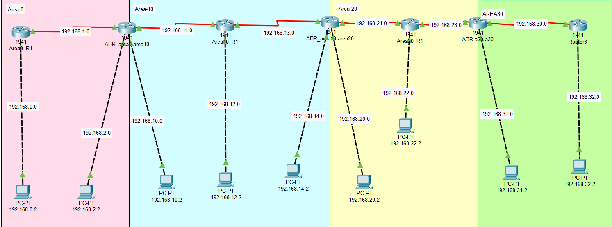
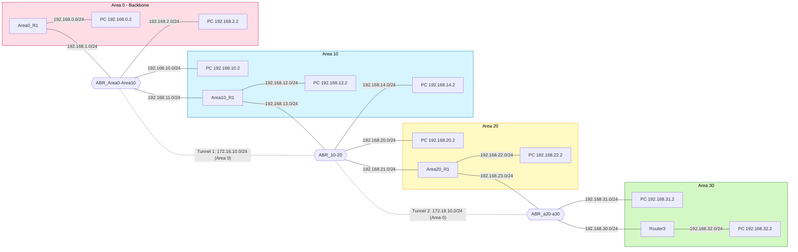

# Multi-Area OSPF with Chained Backbone Extension (Area 0 → 10 → 20 → 30)


A Cisco Packet Tracer lab that builds a four-area OSPF network arranged in a chain (Area 0 → Area 10 → Area 20 → Area 30) and restores backbone connectivity to the areas that are not physically attached to Area 0.

> **Scope:** This is a student lab built in a simulator while studying for the CCNA. It is not a production design and I make no claim of enterprise experience.

> **Terminology note (please read):** In this lab the "virtual links" are **GRE tunnel interfaces whose subnets are advertised into Area 0** between ABRs. This does the same job as an OSPF virtual link (it gives a disconnected ABR an active Area 0 adjacency), but it is **not** the native `area <id> virtual-link` command. The difference is explained in [Backbone Extension](#8-backbone-extension-virtual-link-concept) and a native-command reference is in [`docs/native-virtual-link-reference.md`](docs/native-virtual-link-reference.md).

---

## Table of Contents

1. [Project Overview](#1-project-overview)
2. [Technologies Used](#2-technologies-used)
3. [Network Topology](#3-network-topology)
4. [IP Addressing](#4-ip-addressing)
5. [Area Design](#5-area-design)
6. [OSPF Architecture](#6-ospf-architecture)
7. [LSDB Explanation](#7-lsdb-explanation)
8. [Backbone Extension (Virtual Link Concept)](#8-backbone-extension-virtual-link-concept)
9. [Configuration Highlights](#9-configuration-highlights)
10. [Verification](#10-verification)
11. [Challenges Encountered](#11-challenges-encountered)
12. [Troubleshooting](#12-troubleshooting)
13. [Lessons Learned](#13-lessons-learned)
14. [Skills Demonstrated](#14-skills-demonstrated)
15. [Future Improvements](#15-future-improvements)
16. [Suggested Screenshots](#16-suggested-screenshots)
17. [Repository Structure](#17-repository-structure)
18. [How to Open the Lab](#18-how-to-open-the-lab)
19. [Summary for Recruiters](#19-summary-for-recruiters)

---

## 1. Project Overview

**Goal:** Design and implement a multi-area OSPF topology, then restore backbone connectivity to areas that are not directly connected to Area 0.

**The problem.** OSPF requires every non-backbone area to attach to Area 0, because inter-area traffic and route information flow through the backbone. In this topology the areas are daisy-chained, so only Area 10 touches Area 0. Areas 20 and 30 are cut off from the backbone, and the ABRs serving them cannot exchange inter-area routes.

**The fix.** Two backbone extensions were built across the chain:

| Extension | Between | Transit area | Subnet | Purpose |
|---|---|---|---|---|
| Tunnel 1 (`Tunnel0` ↔ `Tunnel10`) | ABR_Area0-Area10 ↔ ABR_10-20 | Area 10 | `172.16.10.0/24` | Restore backbone connectivity between Area 0 and Area 20 through Area 10 |
| Tunnel 2 (`Tunnel22` ↔ `Tunnel0`) | ABR_10-20 ↔ ABR_a20-a30 | Area 20 | `172.18.10.0/24` | Extend backbone connectivity from Area 20 to Area 30 |

**Result:** After the second extension was added, the Area 30 networks appeared in the routing table as inter-area routes:

```
O IA 192.168.30.0/24 via Tunnel22
O IA 192.168.31.0/24 via Tunnel22
O IA 192.168.32.0/24 via Tunnel22
```

**Network at a glance:** 7 Cisco 1941 routers · 4 OSPF areas · 3 ABRs · 2 backbone-extension tunnels · 9 end-host PCs · OSPF process 1.

---

## 2. Technologies Used

| Technology | Use in this project |
|---|---|
| Cisco Packet Tracer | Network simulation and CLI configuration |
| Cisco 1941 routers (IOS 15.1, per running-config) | All seven routers |
| OSPFv2 (process ID 1) | Dynamic routing across four areas |
| GRE tunnel interfaces | Backbone extension between ABRs (see terminology note) |
| Serial links (DCE clock rate 2000000) | Point-to-point router interconnects |
| GigabitEthernet LANs + PC-PT hosts | Edge networks used as route/test targets |
| Markdown + Mermaid | Documentation and topology diagram |
| Git / GitHub | Version control and publishing |

---

## 3. Network Topology



*Packet Tracer view. Pink = Area 0, blue = Area 10, yellow = Area 20, green = Area 30. Red lines are serial links, dashed black lines are LAN links.*

### Mermaid diagram



*Solid lines are physical links labelled with their subnet. Dotted lines are the logical tunnels that extend Area 0.*

### Backbone as OSPF sees it

Because the tunnel subnets are in Area 0, the backbone is a chain of four routers:

```
Area0_R1 ── ABR_Area0-Area10 ═Tunnel 1═ ABR_10-20 ═Tunnel 2═ ABR_a20-a30
                              (via Area 10)             (via Area 20)
```

### Device name reference

The diagram labels and the hostnames in the captured configs are not identical. The configs in this repo are kept exactly as captured.

| Diagram label | Hostname in running-config |
|---|---|
| Area0_R1 | `Area10_Router1` |
| ABR_area0-area10 | `ABR_Area0-Area10` |
| Area10_R1 | `Area10_R1` |
| ABR_area10-area20 | `ABR_10-20` |
| Area20_R1 | `Area20_R1` |
| ABR a20-a30 | `ABR_a20-a30` |
| Router3 | `area30` |

---

## 4. IP Addressing

### 4.1 Subnets by area

| Area | Subnets | Notes |
|---|---|---|
| **Area 0** | `192.168.0.0/24`, `192.168.1.0/24`, `192.168.2.0/24` | Plus the two tunnel subnets below |
| **Area 10** | `192.168.10.0/24`, `192.168.11.0/24`, `192.168.12.0/24`, `192.168.13.0/24`, `192.168.14.0/24` | |
| **Area 20** | `192.168.20.0/24`, `192.168.21.0/24`, `192.168.22.0/24`, `192.168.23.0/24` | |
| **Area 30** | `192.168.30.0/24`, `192.168.31.0/24`, `192.168.32.0/24` | |
| **Tunnel 1** (Area 0) | `172.16.10.0/24` | `.1` = ABR_Area0-Area10, `.2` = ABR_10-20 |
| **Tunnel 2** (Area 0) | `172.18.10.0/24` | `.1` = ABR_10-20, `.2` = ABR_a20-a30 |

### 4.2 Router interfaces

DCE = side of the serial link providing `clock rate 2000000`.

| Router | Interface | IP address | Connects to | Area | Notes |
|---|---|---|---|---|---|
| **Area0_R1** | Gi0/0 | 192.168.0.1/24 | LAN, PC 192.168.0.2 | 0 | |
| | Se0/0/0 | 192.168.1.1/24 | ABR_Area0-Area10 Se0/0/1 | 0 | DCE |
| **ABR_Area0-Area10** | Gi0/0 | 192.168.2.1/24 | LAN, PC 192.168.2.2 | 0 | |
| | Gi0/1 | 192.168.10.1/24 | LAN, PC 192.168.10.2 | 10 | |
| | Se0/0/0 | 192.168.11.1/24 | Area10_R1 Se0/0/1 | 10 | DCE, tunnel source |
| | Se0/0/1 | 192.168.1.2/24 | Area0_R1 Se0/0/0 | 0 | |
| | Tunnel0 | 172.16.10.1/24 | ABR_10-20 Tunnel10 | 0 | dest 192.168.13.2 |
| **Area10_R1** | Gi0/0 | 192.168.12.1/24 | LAN, PC 192.168.12.2 | 10 | |
| | Se0/0/0 | 192.168.13.1/24 | ABR_10-20 Se0/0/1 | 10 | DCE |
| | Se0/0/1 | 192.168.11.2/24 | ABR_Area0-Area10 Se0/0/0 | 10 | |
| **ABR_10-20** | Gi0/0 | 192.168.14.1/24 | LAN, PC 192.168.14.2 | 10 | |
| | Gi0/1 | 192.168.20.1/24 | LAN, PC 192.168.20.2 | 20 | |
| | Se0/0/0 | 192.168.21.1/24 | Area20_R1 Se0/0/1 | 20 | DCE, Tunnel22 source |
| | Se0/0/1 | 192.168.13.2/24 | Area10_R1 Se0/0/0 | 10 | Tunnel10 source |
| | Tunnel10 | 172.16.10.2/24 | ABR_Area0-Area10 Tunnel0 | 0 | dest 192.168.11.1 |
| | Tunnel22 | 172.18.10.1/24 | ABR_a20-a30 Tunnel0 | 0 | dest 192.168.23.2 |
| **Area20_R1** | Gi0/0 | 192.168.22.1/24 | LAN, PC 192.168.22.2 | 20 | |
| | Se0/0/0 | 192.168.23.1/24 | ABR_a20-a30 Se0/0/1 | 20 | DCE |
| | Se0/0/1 | 192.168.21.2/24 | ABR_10-20 Se0/0/0 | 20 | |
| **ABR_a20-a30** | Gi0/0 | 192.168.31.1/24 | LAN, PC 192.168.31.2 | 30 | |
| | Se0/0/0 | 192.168.30.1/24 | Router3 Se0/0/1 | 30 | DCE |
| | Se0/0/1 | 192.168.23.2/24 | Area20_R1 Se0/0/0 | 20 | Tunnel0 source |
| | Tunnel0 | 172.18.10.2/24 | ABR_10-20 Tunnel22 | 0 | dest 192.168.21.1 |
| **Router3** | Gi0/0 | 192.168.32.1/24 | LAN, PC 192.168.32.2 | 30 | |
| | Se0/0/1 | 192.168.30.2/24 | ABR_a20-a30 Se0/0/0 | 30 | |

### 4.3 End hosts

Host addresses are taken from the topology diagram. PC configuration is not part of the captured router configs, so the default gateway is assumed to be the connected router interface (`.1`).

| PC | IP address | Gateway (assumed) | Area |
|---|---|---|---|
| PC-PT | 192.168.0.2 | 192.168.0.1 | 0 |
| PC-PT | 192.168.2.2 | 192.168.2.1 | 0 |
| PC-PT | 192.168.10.2 | 192.168.10.1 | 10 |
| PC-PT | 192.168.12.2 | 192.168.12.1 | 10 |
| PC-PT | 192.168.14.2 | 192.168.14.1 | 10 |
| PC-PT | 192.168.20.2 | 192.168.20.1 | 20 |
| PC-PT | 192.168.22.2 | 192.168.22.1 | 20 |
| PC-PT | 192.168.31.2 | 192.168.31.1 | 30 |
| PC-PT | 192.168.32.2 | 192.168.32.1 | 30 |

### 4.4 Router IDs (as observed in `show ip ospf neighbor`)

No `router-id` command or loopback was configured, so IDs were selected automatically.

| Router | Router ID | Role |
|---|---|---|
| Area0_R1 | 192.168.1.1 | Internal (backbone) |
| ABR_Area0-Area10 | 192.168.10.1 | ABR (Area 0 / 10) |
| Area10_R1 | 192.168.13.1 | Internal |
| ABR_10-20 | 192.168.21.1 | ABR (Area 10 / 20, plus Area 0 via tunnels) |
| Area20_R1 | 192.168.22.1 | Internal |
| ABR_a20-a30 | 192.168.31.1 | ABR (Area 20 / 30, plus Area 0 via tunnel) |
| Router3 | 192.168.32.1 | Internal |

> **Observation:** two IDs do not match the highest IP currently on the router. ABR_Area0-Area10 shows `192.168.10.1` but has `192.168.11.1` configured, and Area20_R1 shows `192.168.22.1` but has `192.168.23.1`. OSPF picks the router ID when the process starts and does not change it until the process is reset, so the ID reflects the interfaces that were up at that time. Setting `router-id` explicitly avoids this surprise (see [Future Improvements](#15-future-improvements)).

---

## 5. Area Design

| Area | Type | Routers inside | Role in the design |
|---|---|---|---|
| **0** | Backbone | Area0_R1, ABR_Area0-Area10, and (via tunnels) ABR_10-20, ABR_a20-a30 | Transit for all inter-area traffic |
| **10** | Standard (non-backbone) | Area10_R1, plus the Area 10 side of ABR_Area0-Area10 and ABR_10-20 | Transit area for Tunnel 1; contains tunnel endpoints |
| **20** | Standard (non-backbone) | Area20_R1, plus the Area 20 side of ABR_10-20 and ABR_a20-a30 | Transit area for Tunnel 2 |
| **30** | Standard (non-backbone) | Router3, plus the Area 30 side of ABR_a20-a30 | Leaf area, reachable only through the backbone |

**Why a multi-area design?**

- Each area keeps its own LSDB, so a link flap in Area 30 does not force an SPF run in Area 10.
- LSDBs stay smaller, which reduces memory and CPU on routers.
- Areas allow route summarisation at ABRs (not configured here, see future work).

**Why chain the areas?** The linear layout deliberately breaks the "every area must touch Area 0" rule so that the failure, the diagnosis and the fix can all be demonstrated.

**Area assignment method.** Interfaces are placed in areas with `network <address> 0.0.0.255 area <id>` statements. An ABR is simply a router with interfaces in more than one area. For example ABR_10-20 has `192.168.13.0` and `192.168.14.0` in Area 10, `192.168.20.0` and `192.168.21.0` in Area 20, and both tunnel subnets in Area 0.

---

## 6. OSPF Architecture

Each area maintains its own LSDB.

ABRs maintain one LSDB per attached area and exchange inter-area routing information through Type 3 Summary LSAs.

Area 0 functions as the OSPF backbone and all inter-area communication traverses the backbone either directly or through virtual links.

How that maps onto this lab:

| ABR | LSDBs held | Inter-area job |
|---|---|---|
| ABR_Area0-Area10 | Area 0, Area 10 | Summarises Area 0 prefixes into Area 10 and Area 10 prefixes into Area 0 |
| ABR_10-20 | Area 0 (via both tunnels), Area 10, Area 20 | Sits in the middle of the chain; passes routes between all three areas |
| ABR_a20-a30 | Area 0 (via Tunnel 2), Area 20, Area 30 | Injects Area 30 prefixes into the backbone and learns everything else from it |

Other design facts worth noting:

- **Single OSPF process (ID 1)** on every router. The process ID is only locally significant.
- **Network types:** serial links (HDLC) and GRE tunnels are point-to-point, so no DR/BDR election takes place. This matches the neighbor output (`Pri 0`, `FULL/ -`).
- **No ASBR:** nothing is redistributed, so there are no Type 4 or Type 5 LSAs.

---

## 7. LSDB Explanation

OSPF routers in the same area hold an identical link-state database. Each router runs the SPF (Dijkstra) algorithm on its own copy to build a shortest-path tree, then installs the best routes in the routing table.

### 7.1 LSA types in this lab

| LSA type | Name | Originated by | Flooded in | Present here? |
|---|---|---|---|---|
| 1 | Router LSA | Every router | Its own area only | Yes, each router describes its links and attached stub networks |
| 2 | Network LSA | DR on a multi-access segment | Its own area only | Not expected: no segment has more than one OSPF router |
| 3 | Summary LSA | ABRs | Into the neighbouring areas | Yes, this is how inter-area routes travel |
| 4 / 5 | ASBR Summary / External | ASBR | Domain-wide | No, nothing is redistributed |

### 7.2 What each area's database contains

- **Area 0:** Router LSAs for Area0_R1, ABR_Area0-Area10, ABR_10-20 and ABR_a20-a30. The tunnels appear as point-to-point links between the ABRs. Plus Type 3 LSAs for Areas 10, 20 and 30 prefixes.
- **Area 10:** Router LSAs for ABR_Area0-Area10, Area10_R1 and ABR_10-20, plus Type 3 LSAs for everything outside Area 10.
- **Area 20:** Router LSAs for ABR_10-20, Area20_R1 and ABR_a20-a30, plus Type 3 LSAs for everything outside Area 20.
- **Area 30:** Router LSAs for ABR_a20-a30 and Router3, plus Type 3 LSAs for everything outside Area 30.

### 7.3 Following one route: how `192.168.30.0/24` reaches the rest of the network

1. **Router3** describes `192.168.30.0/24` and `192.168.32.0/24` in a Type 1 LSA, flooded inside Area 30.
2. **ABR_a20-a30** (which also holds Area 30's LSDB) runs SPF for Area 30 and originates **Type 3 Summary LSAs** for the Area 30 prefixes. These go into Area 0 across the tunnel and into Area 20.
3. The Type 3 LSAs flood across the backbone. **ABR_10-20** receives them over `Tunnel22` and installs them as `O IA` routes via the tunnel.
4. ABR_10-20 and ABR_Area0-Area10 re-originate the information as Type 3 LSAs into their non-backbone areas, so routers in Areas 10 and 20 also learn the Area 30 prefixes.

Type 3 LSAs carry only a prefix and a cost, not the topology behind it. That is the scaling benefit of areas: routers outside Area 30 never see Area 30's internal links.

### 7.4 Why ABR_10-20 prefers the tunnel path

ABR_10-20 could also learn the same Area 30 summaries through Area 20 (via Area20_R1). Per RFC 2328 an ABR attached to the backbone only considers summary LSAs received from Area 0, so the route is installed through `Tunnel22`. This is consistent with the verification output below.

### 7.5 Why the second tunnel was needed

An ABR can only pass routes between areas if it has an active attachment to Area 0. Before Tunnel 2, ABR_a20-a30 had no Area 0 interface, so Area 30's prefixes were not summarised into the backbone and were missing from other routers' tables.

---

## 8. Backbone Extension (Virtual Link Concept)

### 8.1 The rule

All non-backbone areas must connect to Area 0, directly or logically. OSPF uses the backbone as the hub for inter-area routing, which also keeps inter-area routing loop-free.

### 8.2 The problem in this topology

| Area | Directly attached to Area 0? | Problem |
|---|---|---|
| 10 | Yes, via ABR_Area0-Area10 | None |
| 20 | No, only touches Area 10 | Isolated from the backbone |
| 30 | No, only touches Area 20 | Isolated from the backbone |

### 8.3 What was implemented

Two point-to-point GRE tunnels were created between ABRs. Each tunnel subnet is declared in OSPF as part of **Area 0**, so the ABRs form a normal OSPF adjacency inside Area 0 across the transit area.

| | Tunnel 1 | Tunnel 2 |
|---|---|---|
| Endpoint A | ABR_Area0-Area10 `Tunnel0` `172.16.10.1` | ABR_10-20 `Tunnel22` `172.18.10.1` |
| Tunnel source / destination (A) | `Serial0/0/0` / `192.168.13.2` | `Serial0/0/0` / `192.168.23.2` |
| Endpoint B | ABR_10-20 `Tunnel10` `172.16.10.2` | ABR_a20-a30 `Tunnel0` `172.18.10.2` |
| Tunnel source / destination (B) | `Serial0/0/1` / `192.168.11.1` | `Serial0/0/1` / `192.168.21.1` |
| Transit area | Area 10 | Area 20 |
| Gives Area 0 access to | ABR_10-20 (and so Area 20) | ABR_a20-a30 (and so Area 30) |

**Tunnel destinations are learned through OSPF intra-area routes in the transit area**, not through the tunnel. For example `192.168.13.2` is reached from ABR_Area0-Area10 across Area 10. If the transit area broke, the tunnel and the backbone extension would break with it.

### 8.4 Tunnel versus native virtual link

| | GRE tunnel in Area 0 (**this lab**) | Native OSPF virtual link |
|---|---|---|
| Configuration | `interface TunnelX` + `network ... area 0` | `area <transit> virtual-link <remote-RID>` |
| Neighbor shown on interface | `TunnelX` | `OSPF_VL0` |
| `show ip ospf virtual-links` | Shows nothing | Shows the link state |
| Extra encapsulation | Yes (GRE; tunnel MTU set to 1476 here) | No |
| Needs a tunnel IP subnet | Yes (`172.16.10.0/24`, `172.18.10.0/24`) | No |
| Identifies peer by | Tunnel source/destination IPs | Router ID |

Both approaches give the ABR an Area 0 adjacency. Both are workarounds: the usual real-world fix is to redesign so every area attaches to Area 0.

A native `area X virtual-link` version of this topology is documented as an **untested reference** in [`docs/native-virtual-link-reference.md`](docs/native-virtual-link-reference.md).

---

## 9. Configuration Highlights

Full running-configs are in [`configs/`](configs/). The parts that matter most are below.

**ABR_10-20 (middle ABR: three areas plus two tunnels)**

```
interface Tunnel10
 ip address 172.16.10.2 255.255.255.0
 mtu 1476
 tunnel source Serial0/0/1
 tunnel destination 192.168.11.1
!
interface Tunnel22
 ip address 172.18.10.1 255.255.255.0
 mtu 1476
 tunnel source Serial0/0/0
 tunnel destination 192.168.23.2
!
router ospf 1
 log-adjacency-changes
 network 192.168.13.0 0.0.0.255 area 10
 network 192.168.14.0 0.0.0.255 area 10
 network 192.168.20.0 0.0.0.255 area 20
 network 192.168.21.0 0.0.0.255 area 20
 network 172.16.10.0 0.0.0.255 area 0
 network 172.18.10.0 0.0.0.255 area 0
```

**ABR_Area0-Area10 (backbone to Area 10, Tunnel 1 endpoint)**

```
interface Tunnel0
 ip address 172.16.10.1 255.255.255.0
 mtu 1476
 tunnel source Serial0/0/0
 tunnel destination 192.168.13.2
!
router ospf 1
 network 192.168.1.0 0.0.0.255 area 0
 network 192.168.2.0 0.0.0.255 area 0
 network 172.16.10.0 0.0.0.255 area 0
 network 192.168.10.0 0.0.0.255 area 10
 network 192.168.11.0 0.0.0.255 area 10
```

**ABR_a20-a30 (Area 20 / Area 30, Tunnel 2 endpoint)**

```
interface Tunnel0
 ip address 172.18.10.2 255.255.255.0
 mtu 1476
 tunnel source Serial0/0/1
 tunnel destination 192.168.21.1
!
router ospf 1
 network 192.168.23.0 0.0.0.255 area 20
 network 192.168.31.0 0.0.0.255 area 30
 network 192.168.30.0 0.0.0.255 area 30
 network 172.18.10.0 0.0.0.255 area 0
```

| Device | Config file |
|---|---|
| Area0_R1 | [`configs/01_Area0_R1.cfg`](configs/01_Area0_R1.cfg) |
| ABR_Area0-Area10 | [`configs/02_ABR_Area0-Area10.cfg`](configs/02_ABR_Area0-Area10.cfg) |
| Area10_R1 | [`configs/03_Area10_R1.cfg`](configs/03_Area10_R1.cfg) |
| ABR_10-20 | [`configs/04_ABR_10-20.cfg`](configs/04_ABR_10-20.cfg) |
| Area20_R1 | [`configs/05_Area20_R1.cfg`](configs/05_Area20_R1.cfg) |
| ABR_a20-a30 | [`configs/06_ABR_a20-a30.cfg`](configs/06_ABR_a20-a30.cfg) |
| Router3 | [`configs/07_Router3.cfg`](configs/07_Router3.cfg) |
| Original capture | [`configs/raw/captured-running-configs.txt`](configs/raw/captured-running-configs.txt) |

---

## 10. Verification

### 10.1 OSPF neighbors (captured output)

All adjacencies are `FULL`. Priority 0 and the `-` after `FULL/` show point-to-point links with no DR/BDR election.

**ABR_Area0-Area10**

```
Neighbor ID     Pri   State           Dead Time   Address         Interface
192.168.1.1       0   FULL/  -        00:00:37    192.168.1.1     Serial0/0/1
192.168.21.1      0   FULL/  -        00:00:37    172.16.10.2     Tunnel0
192.168.13.1      0   FULL/  -        00:00:37    192.168.11.2    Serial0/0/0
```

**ABR_10-20**

```
Neighbor ID     Pri   State           Dead Time   Address         Interface
192.168.13.1      0   FULL/  -        00:00:34    192.168.13.1    Serial0/0/1
192.168.22.1      0   FULL/  -        00:00:34    192.168.21.2    Serial0/0/0
192.168.10.1      0   FULL/  -        00:00:34    172.16.10.1     Tunnel10
192.168.31.1      0   FULL/  -        00:00:34    172.18.10.2     Tunnel22
```

**ABR_a20-a30**

```
Neighbor ID     Pri   State           Dead Time   Address         Interface
192.168.22.1      0   FULL/  -        00:00:36    192.168.23.1    Serial0/0/1
192.168.32.1      0   FULL/  -        00:00:37    192.168.30.2    Serial0/0/0
192.168.21.1      0   FULL/  -        00:00:36    172.18.10.1     Tunnel0
```

### 10.2 Inter-area routes (abridged)

Area 30 networks learned as inter-area routes through the second tunnel:

```
O IA 192.168.30.0/24 via Tunnel22
O IA 192.168.31.0/24 via Tunnel22
O IA 192.168.32.0/24 via Tunnel22
```

`Tunnel22` exists only on ABR_10-20, so this output is from that router; the next hop is the far end of Tunnel 2, `172.18.10.2`.

### 10.3 What the evidence shows

| Observation | Meaning |
|---|---|
| Tunnel neighbors (`Tunnel0`, `Tunnel10`, `Tunnel22`) are `FULL` | The ABRs have working Area 0 adjacencies across the transit areas |
| ABR_10-20 has four `FULL` neighbors | It is connected to both transit areas and both tunnels |
| Area 30 prefixes are `O IA` | They were learned through Type 3 LSAs from another area (inter-area), not from inside Area 10 or 20 |
| Next hop is the tunnel | Inter-area traffic uses the extended backbone |

### 10.4 Commands used

Copy-paste lists per device are in [`verification/commands.md`](verification/commands.md). The core ones:

```
show ip route
show ip route ospf
show ip ospf neighbor
show ip ospf database
show ip ospf interface
show ip protocols
show interfaces tunnel 10
show ip interface brief
```

> Some `show` command variants differ between Packet Tracer and real IOS. If a command is rejected, try the shorter form.

### 10.5 Evidence still worth adding

The three neighbor tables and the three `O IA` lines are the only captured outputs available. Before publishing, consider adding the items in [`docs/screenshots.md`](docs/screenshots.md), in particular full `show ip route` output and an end-to-end ping from `192.168.0.2` to `192.168.32.2`.

---

## 11. Challenges Encountered

### Issue 1: Area 20 Not Connected to the Backbone

**Problem:** Area 20 was not directly connected to Area 0.

**Resolution:** Extended Area 0 through Area 10 by building a tunnel between ABR_Area0-Area10 and ABR_10-20 and advertising the tunnel subnet (`172.16.10.0/24`) in Area 0. This gave ABR_10-20 an active Area 0 adjacency.

### Issue 2: Area 30 Routes Not Appearing

**Problem:** Area 30 networks were not visible in the routing table.

**Resolution:** Built a second tunnel across Area 20 between ABR_10-20 and ABR_a20-a30 (`172.18.10.0/24`, Area 0) and verified route propagation using:

```
show ip route
show ip ospf neighbor
show interfaces tunnel 22
```

**Result:** Area 30 networks appeared as `O IA` routes.

---

## 12. Troubleshooting

### 12.1 Method

Work up the stack and stop at the first failure:

1. **Layer 1/2:** `show ip interface brief`. Are the interfaces `up/up`? On a serial link, is `clock rate` set on the DCE side?
2. **Layer 3:** Can the neighbor address be pinged?
3. **OSPF adjacency:** `show ip ospf neighbor`. Is every expected neighbor `FULL`?
4. **OSPF database/routes:** `show ip ospf database`, `show ip route ospf`.

### 12.2 Symptom table

| Symptom | Likely cause | Check | Fix |
|---|---|---|---|
| Neighbor missing entirely | Interface down, wrong subnet, interface not matched by a `network` statement, `passive-interface` | `show ip interface brief`, `show ip protocols` | Fix addressing or add the right `network` statement |
| Neighbor stuck in `INIT` | One-way hello: the other side is not hearing us | `show ip ospf interface` on both ends | Check ACLs, link, and that the other side has the interface in OSPF |
| Neighbor stuck in `EXSTART` / `EXCHANGE` | MTU mismatch | `show interfaces` on both ends | Match MTU (note the tunnels use 1476) |
| Neighbors never form despite correct IPs | Area ID, hello/dead timer, or authentication mismatch | `show ip ospf interface` | Make both ends agree |
| Tunnel is `up` but no OSPF neighbor | Tunnel subnet not in an OSPF `network` statement | `show ip protocols`, `show run \| section ospf` | Add `network 172.x.x.0 0.0.0.255 area 0` |
| Tunnel line protocol `down` | Wrong tunnel source/destination, or destination unreachable | `show interfaces tunnel X`, ping the tunnel destination | Correct source/destination, fix underlay routing |
| Routes from a far area missing (**Issues 1 and 2 in this lab**) | The ABR serving that area has no active Area 0 attachment | `show ip ospf neighbor` on the ABR: is there an Area 0 neighbor? | Extend Area 0 to that ABR |
| Duplicate router ID warnings | Two routers with the same RID | `show ip ospf` | Set unique `router-id`, then `clear ip ospf process` |
| Wrong area for a link | Wildcard mask too broad/narrow, or `network` statement in wrong area | `show ip ospf interface` | Correct the `network` statement |

### 12.3 Diagnosing this lab's two failures

- **Area 20 isolated:** ABR_10-20 had interfaces only in Areas 10 and 20, so no Area 0 neighbor appeared in `show ip ospf neighbor`. Adding Tunnel 1 as an Area 0 link produced a `FULL` neighbor on `Tunnel10`.
- **Area 30 routes missing:** the same check on ABR_a20-a30 showed only Area 20 and Area 30 neighbors. Adding Tunnel 2 produced `FULL` neighbors on `Tunnel22` / `Tunnel0` and the Area 30 prefixes appeared as `O IA`.

---

## 13. Lessons Learned

- **The backbone rule is structural.** Without Area 0 attachment, an ABR cannot do its job, and missing routes are the symptom.
- **Adjacency state tells you where to look.** `show ip ospf neighbor` answered most questions before the route table was needed.
- **Area membership is per interface, not per router.** An ABR is just a router whose interfaces sit in different areas.
- **Type 3 LSAs hide topology.** Routers outside an area know prefixes and costs, not the links behind them.
- **Tunnels need a working underlay.** The tunnel only stays up while the transit area can route between its endpoints.
- **Router IDs should be explicit.** Auto-selected IDs depend on startup order and can surprise you later.
- **Tunnels and native virtual links are not the same thing.** They solve the same problem differently and show up differently in `show` output.

---

## 14. Skills Demonstrated

| Skill | Where it appears |
|---|---|
| OSPF areas and multi-area design | Sections 5, 6 |
| OSPF process configuration (`router ospf`, `network` statements, wildcard masks) | Section 9, `configs/` |
| Router IDs | Section 4.4 |
| OSPF adjacencies and neighbor states | Sections 10.1, 12 |
| LSDB synchronisation and LSA types | Section 7 |
| SPF calculation (concept and effect) | Section 7 |
| Area Border Routers | Sections 5, 6, 7 |
| Intra-area (`O`) and inter-area (`O IA`) routes | Sections 7, 10 |
| Backbone extension (tunnel-based, with native virtual-link comparison) | Section 8, `docs/` |
| GRE tunnel configuration | Sections 8, 9 |
| IP addressing and subnet planning | Section 4 |
| Serial link configuration (DCE/clock rate) | Section 4.2 |
| Systematic troubleshooting | Sections 11, 12 |
| Technical documentation, diagrams, Git/GitHub | Whole repository |

---

## 15. Future Improvements

- [ ] **Set explicit router IDs** (or add loopbacks) so IDs are stable and predictable.
- [ ] **Build the native `area X virtual-link` version** and compare `show` output against the tunnel version ([reference](docs/native-virtual-link-reference.md)).
- [ ] **Redesign without workarounds:** connect every area to Area 0 so no tunnel or virtual link is needed.
- [ ] **Passive interfaces** on PC-facing LANs so OSPF hellos are not sent to hosts.
- [ ] **OSPF authentication** (MD5/SHA) on router-to-router links.
- [ ] **Route summarisation** at ABRs with `area <id> range`, using a contiguous addressing plan.
- [ ] **Stub / totally stubby area** for Area 30 to reduce LSDB size.
- [ ] **Basic device hardening:** passwords, `enable secret`, SSH instead of open `line vty` with `login`.
- [ ] **Rename hostnames** so diagram labels and configs match.
- [ ] **Failure testing:** shut a transit link and document how the backbone partitions.
- [ ] **OSPFv3 / IPv6** version of the lab.
- [ ] **Automation:** back up configs with a small Python script.
- [ ] **Recreate in GNS3 or EVE-NG** using real IOS images.

---

## 16. Suggested Screenshots

Full list with exact commands in [`docs/screenshots.md`](docs/screenshots.md). Priority items:

| # | Screenshot | Device | Why |
|---|---|---|---|
| 1 | Full topology | Packet Tracer workspace | Shows the design at a glance |
| 2 | `show ip ospf neighbor` | ABR_10-20 | Four `FULL` neighbors including both tunnels |
| 3 | `show ip route` | ABR_10-20 | The `O IA` Area 30 routes |
| 4 | `show ip ospf database` | ABR_10-20 | Per-area LSDBs and Type 3 LSAs |
| 5 | `show interfaces tunnel 22` | ABR_10-20 | Tunnel source, destination, up/up |
| 6 | Ping `192.168.0.2` → `192.168.32.2` | PC | End-to-end proof |

Save images in `docs/images/screenshots/`.

---

## 17. Repository Structure

```
ospf-multiarea-backbone-lab/
├── README.md
├── LICENSE
├── .gitignore
├── lab/
│   └── OSPF_MultiAREA_RETRY.pkt
├── configs/
│   ├── 01_Area0_R1.cfg
│   ├── 02_ABR_Area0-Area10.cfg
│   ├── 03_Area10_R1.cfg
│   ├── 04_ABR_10-20.cfg
│   ├── 05_Area20_R1.cfg
│   ├── 06_ABR_a20-a30.cfg
│   ├── 07_Router3.cfg
│   └── raw/
│       └── captured-running-configs.txt
├── verification/
│   ├── commands.md
│   └── captured-outputs/
│       ├── show-ip-ospf-neighbor_ABR_Area0-Area10.txt
│       ├── show-ip-ospf-neighbor_ABR_10-20.txt
│       └── show-ip-ospf-neighbor_ABR_a20-a30.txt
└── docs/
    ├── images/
    │   ├── topology.png
    │   └── screenshots/
    ├── native-virtual-link-reference.md
    ├── portfolio-description.md
    ├── commit-history.md
    └── screenshots.md
```

---

## 18. How to Open the Lab

1. Install [Cisco Packet Tracer](https://www.netacad.com/) (free with a Cisco Networking Academy account).
2. Open [`lab/OSPF_MultiAREA_RETRY.pkt`](lab/OSPF_MultiAREA_RETRY.pkt).
3. Click a router, open the **CLI** tab, and use the commands in [`verification/commands.md`](verification/commands.md).
4. To rebuild from scratch, paste the matching file from [`configs/`](configs/) into each router.

---

## 19. Summary for Recruiters

**Multi-Area OSPF lab (Cisco Packet Tracer).** A self-directed CCNA-level project. I designed a seven-router, four-area OSPF network in which two areas were cut off from the backbone, diagnosed why inter-area routes were missing, and restored backbone connectivity by extending Area 0 across two transit areas. I verified the result with neighbor tables and routing-table output (`O IA` routes) and documented the design, LSDB behaviour, troubleshooting method and the limits of the approach (including how it differs from a native OSPF virtual link).

*Relevant for:* entry-level network engineer, NOC and infrastructure support roles. More variants (GitHub description, LinkedIn text, resume bullets, interview talking points) are in [`docs/portfolio-description.md`](docs/portfolio-description.md).

---

**Author:** [Your Name](https://github.com/your-username) · Built as hands-on CCNA practice · Licensed under the [MIT License](LICENSE)
